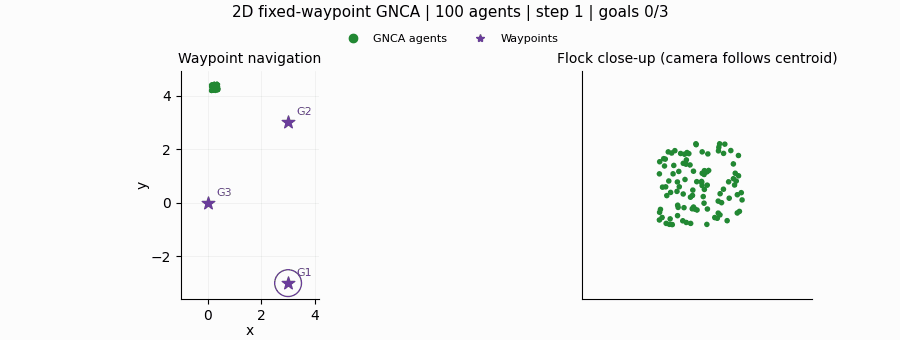
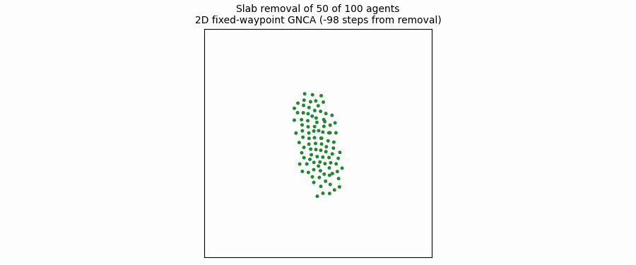

# Learning Collective Goal-Directed Behavior with Graph Neural Cellular Automata

Code supplement for the paper *Learning Collective Goal-Directed Behavior with Graph Neural Cellular Automata*
(Mihir Bhat). It contains the code to run the
experiments the paper describes: training graph neural cellular automata (GNCA)
that steer a swarm through waypoints in 2D and 3D by imitating a goal-conditioned
Boids expert, and evaluating them against that expert. Included are the 2D and 3D
Boids experts, the GNCA models, and the training and evaluation scripts. No
trained weights, datasets or results are distributed: every model, result and
plot is produced by running the commands below.



## Setup

For CPU training or evaluation, use Python 3.10 or 3.11:

```sh
pip install -r requirements.txt
python -m experiments.check_environment --smoke
```

The smoke check builds each of the four models and runs one forward step. For NVIDIA GPU training, use the supplied
[Docker setup](docs/USAGE.md#nvidia-gpu-container).

Every command below is run from the repository root through one launcher,
`experiments.run`, which takes an action and an experiment name:

| Experiment | Task |
| --- | --- |
| `fixed2d`, `fixed3d` | Follow a fixed sequence of waypoints (three in 2D, two in 3D); the model receives no goal input |
| `online2d`, `online3d` | Follow waypoints sampled at random and revealed one at a time; the model receives the vector to the active goal |

```sh
python -m experiments.run --help
python -m experiments.run train fixed2d --dry-run   # print the plan without running it
```

To watch the Boids expert itself:

```sh
python -m evaluation.visualization.show_boids                              # 2D, fixed waypoints
python -m evaluation.visualization.show_boids --experiment fixed3d         # 3D
python -m evaluation.visualization.show_boids --waypoints 2,-3 -2,3 0,0
```

## Training

```sh
python -m experiments.run train fixed2d
python -m experiments.run train fixed3d
python -m experiments.run train online2d
python -m experiments.run train online3d
```

Each command runs two stages back to back:

1. **One-step pretraining.** The model learns single expert transitions. One third
   of the trajectories are perturbed: a few agents are pushed off course at regular
   intervals and the expert steers them back, so the model also learns to recover.
2. **BPTT fine-tuning.** Starting from stage 1's weights with a fresh optimizer, the
   model rolls out K steps from each expert state on new, unperturbed trajectories,
   and the loss is backpropagated through the rollout.

| | `fixed2d` | `fixed3d` | `online2d` | `online3d` |
| --- | --- | --- | --- | --- |
| Expert perception / crowding / start box | 0.05 / 0.02 / 0.325 | 0.105 / 0.06 / 0.4 | 0.05 / 0.02 / 0.325 | 0.105 / 0.06 / 0.4 |
| Stage 1 trajectories (perturbed) | 2,500 (833) | 15,000 (5,000) | 2,500 (833) | 15,000 (5,000) |
| Stage 1 chunk size / batch | 500 / 256 | 1,000 / 1,024 | 500 / 256 | 1,000 / 1,024 |
| Stage 2 trajectories / chunk size | 500 / 500 | 3,000 / 1,000 | 500 / 500 | 3,000 / 1,000 |
| Stage 2 window K / batch | 16 / 256 | 64 / 512 | 16 / 256 | 32 / 512 |

New checkpoints are written to `saved_models/<experiment>_s0_onestep` and, after
stage 2, `saved_models/<experiment>_s0`, and the launcher prints the exact path
before training starts. No trained weights are distributed with this repository.
`--stage onestep` stops after stage 1, and `--stage bptt --init-weights <one-step checkpoint>`
runs stage 2 alone. `--label` only renames the outputs.
Every other setting is in the experiment's preset, `experiments/presets/<experiment>.json`;
[the preset guide](docs/USAGE.md#preset-files) explains each field.

## Evaluating a trained model

Pass the checkpoint prefix that training printed, without the `.index` ending:

```sh
python -m experiments.run evaluate fixed2d --weights saved_models/fixed2d_s0
```

Each command rolls out the GNCA and the Boids expert from the same 40 starts in
2D (10 per quadrant) or 80 in 3D (10 per octant), with 100 agents and at most
5,000 steps. A rollout is complete when the swarm centroid has come within 0.5
units of every waypoint in order. Dynamic-waypoint rollouts visit five random
waypoints. Results go to `results/evaluate/<experiment>_seed460/`:

| File | Contents |
| --- | --- |
| `summary.txt` | Completion counts and flock metrics, GNCA against Boids |
| `per_run.csv` | One row per start: completion, failure type, and per-rollout statistics of the flock metrics and neighbor counts |
| `paper_summary.csv` | Median and quartiles across rollouts |
| `radius_series.npz` | The flock radius and the neighbor count at every step of every rollout |
| `series_report.txt` | The flock radius and neighbor count over time, GNCA against Boids |
| `completion.pdf`, `metrics.pdf` | Task completion, and the per-rollout flock metrics of both controllers |

The starts run in parallel, one process per visible GPU by default; set the
number with `--workers`.

## Further experiments

**Agent removal.** Removes 50 agents in a slab through the flock
centroid once during each rollout, at the same step and orientation for the
GNCA and the expert, next to an unmodified baseline:

```sh
python -m experiments.run removal fixed2d --weights saved_models/fixed2d_s0
```

<p align="center">
  
</p>

Besides the evaluation files above, it writes `recovery.pdf`, the median flock
radius of the GNCA around the removal step. A filmstrip of the flock
around one removal is drawn by

```sh
python -m evaluation.visualization.slab_filmstrip --weights saved_models/fixed2d_s0
```

**Imitation fidelity.** Generates 50 new expert rollouts and applies the GNCA
one step ahead at every tenth expert state, so the GNCA never drives the
trajectory. It reports the one-step root mean squared error over the next state,
the angle between predicted and actual next velocity, and the relative speed
error, each as the mean over all agent-steps with the standard deviation across
rollouts:

```sh
python -m experiments.run imitation fixed2d --weights saved_models/fixed2d_s0
```

**Swarm size.** Evaluates a model trained on 100 agents at other swarm sizes,
without retraining. Only the GNCA is rolled out, unless `--with-boids` is given. By default, 25 and 200 agents start at the training
density (the side of the starting box grows as `init_scatter * (N / 100) ** (1 / d)`),
and 250 agents are placed in the training box itself:

```sh
python -m experiments.run scaling fixed2d --weights saved_models/fixed2d_s0
python -m experiments.run scaling fixed2d --weights saved_models/fixed2d_s0 --sizes 50 200 --training-box-sizes 300
```

Each size is written to `results/scaling/<experiment>_seed460/constant_density/n<N>/`
or `.../training_box/n<N>/`, and `scaling.pdf` plots the GNCA completion and flock radius
against the swarm size. Sizes already evaluated are skipped when the command is
run again.

**Neighbor counts.** Counts the neighbors each agent sees along the GNCA
rollouts at a given swarm size:

```sh
python -m evaluation.neighbor_counts --experiment online2d --weights saved_models/online2d_s0 --n_boids 25 --output_dir results/neighbor_counts/online2d_n25
```

**Trajectories.** Draws the GNCA trajectories of a trained model:

```sh
python -m evaluation.visualization.trajectories fixed2d --weights saved_models/fixed2d_s0 --mode tubular
```

## Documentation

- [Detailed usage](docs/USAGE.md): installation, stages, preset fields, output names
- [Experiment details](docs/EXPERIMENT_DETAILS.md): training recipes, metrics
- [Code organization](docs/ARCHITECTURE.md): where each part of the code lives

## Attribution

This code builds on Grattarola, Livi, and Alippi,
[*Learning Graph Cellular Automata*](https://github.com/danielegrattarola/GNCA)
(NeurIPS 2021). Attribution to the original work is provided in
[docs/USAGE.md](docs/USAGE.md#attribution).

## License

The original code of this repository is released under the [MIT License](LICENSE).
Code derived from the upstream GNCA repository remains the work of its authors
and is not relicensed; see [LICENSE](LICENSE).
