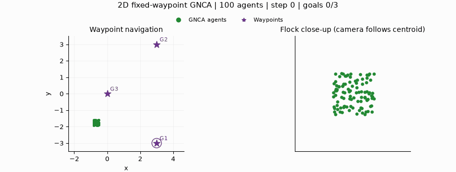
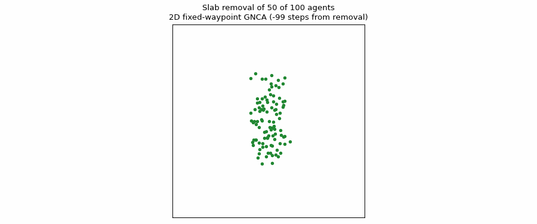

# Learning Collective Goal-Directed Behavior with Graph Neural Cellular Automata

Code supplement for the paper *Learning Collective Goal-Directed Behavior with Graph Neural Cellular Automata*
(Mihir Bhat). It contains the code to run the
experiments the paper describes: training graph neural cellular automata (GNCA)
that steer a swarm through waypoints in 2D and 3D by imitating a goal-conditioned
Boids expert, and evaluating them against that expert. Included are the 2D and 3D
Boids experts, the GNCA models, and the training and evaluation scripts. No
trained weights, datasets or results are distributed: every model, result and
plot is produced by running the commands below.



## Setup

For CPU training or evaluation, use Python 3.10 or 3.11:

```sh
pip install -r requirements.txt
python -m experiments.check_environment --smoke
```

The smoke check builds each of the four models and runs one forward step. For NVIDIA GPU training, use the supplied
[Docker setup](docs/USAGE.md#nvidia-gpu-recommended-container).

Every command below is run from the repository root through one launcher,
`experiments.run`, which takes an action and an experiment name:

| Experiment | Task |
| --- | --- |
| `fixed2d`, `fixed3d` | Follow a fixed sequence of waypoints (three in 2D, two in 3D); the model receives no goal input |
| `online2d`, `online3d` | Follow waypoints sampled at random and revealed one at a time; the model receives the vector to the active goal |

```sh
python -m experiments.run --help
python -m experiments.run train fixed2d --dry-run   # print the commands without running them
```

Each command trains or evaluates one model with one seed. To obtain results
from several independently trained models, run the command again with another
`--seed` (and `--label`, so the outputs do not collide).

To watch the Boids expert itself:

```sh
python -m boids.show_boids                       # 2D, fixed waypoints
python -m boids.show_boids --dimension 3         # 3D
python -m boids.show_boids --waypoints 2,-3 -2,3 0,0
```

## Training

```sh
python -m experiments.run train fixed2d
python -m experiments.run train fixed3d
python -m experiments.run train online2d
python -m experiments.run train online3d
```

| Experiment | Training data | Default pipeline |
| --- | --- | --- |
| `fixed2d` | 500 starting centers, each run twice | `local` (cached on disk) |
| `fixed3d` | 8,000 unperturbed and 4,000 perturbed trajectories, balanced over the octants | `cloud` |
| `online2d` | 1,000 unperturbed and 500 perturbed trajectories | `cloud` (compiled, in memory, GPU) |
| `online3d` | 8,000 unperturbed and 4,000 perturbed trajectories | `cloud` |

In a perturbed trajectory a few agents are pushed off course at regular
intervals and the expert steers them back, so the model also learns to recover.
Every experiment runs with either pipeline, chosen with `--backend local` or
`--backend cloud`. These are two ways of producing and batching the expert data;
`cloud` needs a GPU but no cloud service.

New checkpoints are written to `saved_models/best_weights_<run tag>`, and the
launcher prints the exact path before training starts. No trained weights are
distributed with this repository. Common settings can be changed on the
command line:

```sh
python -m experiments.run train online2d --batch-size 256 --epochs 100 --seed 42 --label custom
```

`--label` only renames the outputs (here with the suffix `_custom`). Every other
setting is in the experiment's preset, `experiments/presets/<experiment>.json`;
[the preset guide](docs/USAGE.md#preset-files) explains each field.

## Evaluating a trained model

Pass the checkpoint prefix that training printed, without the `.index` ending:

```sh
python -m experiments.run evaluate fixed2d --weights saved_models/best_weights_<run tag>
```

Each command rolls out the GNCA and the Boids expert from the same 40 starts in
2D (10 per quadrant) or 80 in 3D (10 per octant), with 100 agents and at most
5,000 steps. A rollout is complete when the swarm centroid has come within 0.5
units of every waypoint in order. Dynamic-waypoint rollouts visit five random
waypoints. Results go to `results/evaluate/<experiment>_seed460/`:

| File | Contents |
| --- | --- |
| `summary.txt` | Completion counts and flock metrics, GNCA against Boids |
| `per_run.csv` | One row per start: completion, failure type, and per-rollout statistics of the flock metrics |
| `paper_summary.csv` | Median and quartiles across rollouts |
| `radius_series.npz` | The flock radius at every step of every rollout |
| `completion.pdf`, `metrics.pdf` | Task completion, and the per-rollout flock metrics of both controllers |

The starts run in parallel, one process per visible GPU by default; set the
number with `--workers`. Use `--seed` for a different set of starts.

## Further experiments

**Agent removal.** Removes 10, 25 or 50 agents in a slab through the flock
centroid once during each rollout, at the same step and orientation for the
GNCA and the expert, next to an unmodified baseline:

```sh
python -m experiments.run removal fixed2d --weights saved_models/best_weights_<run tag>
```

<p align="center">
  
</p>

Besides the evaluation files above, it writes `recovery.pdf`, the median flock
radius of the GNCA around the removal step. A filmstrip of the flock
around one removal is drawn by

```sh
python -m evaluation.visualization.slab_filmstrip --weights saved_models/best_weights_<run tag>
```

**Imitation fidelity.** Generates 50 new expert rollouts and applies the GNCA
one step ahead at every tenth expert state, so the GNCA never drives the
trajectory. It reports the one-step root mean squared error over the next state,
the angle between predicted and actual next velocity, and the relative speed
error, each as the mean over all agent-steps with the standard deviation across
rollouts:

```sh
python -m experiments.run imitation fixed2d --weights saved_models/best_weights_<run tag>
```

**Swarm size.** Evaluates a model trained on 100 agents at other swarm sizes,
without retraining. Only the GNCA is rolled out. By default, 25 and 500 agents start at the training
density (the side of the starting box grows as `0.325 * (N / 100) ** (1 / d)`),
and 200 and 500 agents are placed in the training box itself:

```sh
python -m experiments.run scaling fixed2d --weights saved_models/best_weights_<run tag>
python -m experiments.run scaling fixed2d --weights saved_models/best_weights_<run tag> --sizes 50 200 --training-box-sizes 300
```

Each size is written to `results/scaling/<experiment>_seed460/constant_density/n<N>/`
or `.../training_box/n<N>/`, and `scaling.pdf` plots the GNCA completion and flock radius
against the swarm size. Sizes already evaluated are skipped when the command is
run again.

**Neighbor counts.** Counts the neighbors each agent sees along the GNCA
rollouts at a given swarm size:

```sh
python -m evaluation.neighbor_counts --dimension 2 --task online_goals --weights_path saved_models/best_weights_<run tag> --n_boids 25 --output_dir results/neighbor_counts/online2d_n25
```

## Documentation

- [Detailed usage](docs/USAGE.md): installation, pipelines, preset fields, output names
- [Experiment details](docs/EXPERIMENT_DETAILS.md): training recipes, metrics
- [Code organization](docs/ARCHITECTURE.md): where each part of the code lives

## Attribution

This code builds on Grattarola, Livi, and Alippi,
[*Learning Graph Cellular Automata*](https://github.com/danielegrattarola/GNCA)
(NeurIPS 2021). Attribution to the original work is provided in
[docs/USAGE.md](docs/USAGE.md#attribution).

## License

The original code of this repository is released under the [MIT License](LICENSE).
Code derived from the upstream GNCA repository remains the work of its authors
and is not relicensed; see [LICENSE](LICENSE).
